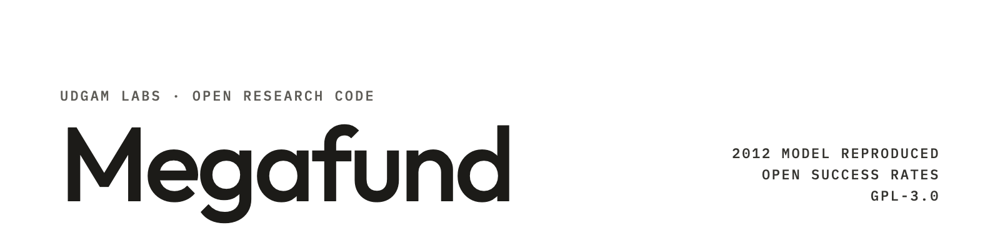

**UDGAM LABS** · Research code · A cancer megafund on open drug success rates

# Open Megafund

In 2012 Fernandez, Stein and Lo proposed a "cancer megafund": finance many cancer drug projects at once with bonds and
equity, so that a few successes pay for many failures. Whether it works depends on two inputs: each phase's chance of
success, and how much failures cluster. This repository holds a Python port of the 2012 simulator, a test that
reproduces the paper's own result, and a script that rebuilds the success rates from public records
([Open Cancer Drug Paths](https://huggingface.co/datasets/udgamlabs/open-cancer-drug-paths)) and runs both funds on
them. A research tool, not investment advice.

[Lab note](https://udgamlabs.com/blog/open-megafund) · [Simulator in your browser](https://udgamlabs.com/tools/megafund) · [Dataset](https://huggingface.co/datasets/udgamlabs/open-cancer-drug-paths) · [udgamlabs.com](https://udgamlabs.com)

## Get started

```bash
git clone https://github.com/udgamlabs/open-megafund && cd open-megafund
pip install -r requirements.txt

python -m megafund t1          # reproduce the 2012 paper: funds A and B, 10,000 simulated funds each
python -m megafund rates       # the four cancer success rates, from the public dataset (downloads about 5 MB)
python -m megafund table       # both funds on the 2012, 2019 and open-data rates
python -m megafund sim B --n 2000 --trans-rho 0.26   # one fund, with correlated phase transitions
python -m pytest -q tests/     # quick checks
```

Python 3.10 or later. `t1` and `table` use several processes (`--workers`, default 4) and take a few minutes on a
laptop.

## How it works

- **The simulator** (`megafund/sim.py`) is a Python port of RBOMatlab's `simulate_CFs_fn` (Markov mode, one compound
  type, no guarantee). Each simulated fund buys drug projects, moves each one through the phases every half-year,
  sells it at the fund's sale phase (phase 2 for fund A, approval for fund B), pays bond coupons and principal, and
  passes what is left to equity. Sale values are correlated across projects through one common factor, as in 2012.
- **An extension:** `--trans-rho` makes the phase transitions themselves correlated (a one-factor Gaussian copula with
  a fresh common factor each period), so failures can cluster.
- **The inputs** (`inputs/fsl2012/`) are the paper's two parameter files, unchanged (`SOURCE.md`); `megafund/params.py`
  reads them.
- **The rates** (`megafund/rates.py`) come from the `paths` table of the public dataset: 6,952 drug-and-cancer paths
  from 64,601 ClinicalTrials.gov trials (industry-sponsored, first trial from 2000 to October 2015), joined to FDA, EMA
  and PMDA approvals. A rate is successes over successes plus failures; intervals resample drugs.
- **The table** swaps in each rate set for the phase 1, 2 and 3 rows of the 2012 model. Each row keeps its chance of
  staying put, so durations, costs, values and the approval-review step stay as in 2012.

## Results

**T1, the reproduction.** Over 10,000 simulated funds each, the port gives 9.2% a year for fund A and 10.6% for fund B;
RBOMatlab's own tests expect 9.1% and 10.6%. Both are within the 1.645-standard-error pass mark.

**Cancer success rates.**

| Transition | Open data (95% interval) | 2019 paid data (Wong, Siah, Lo) | 2012 megafund inputs |
|---|---|---|---|
| Phase 1 → 2 | 77.9% (75.7-80.1) | 57.6% | 72.3% |
| Phase 2 → 3 | 42.8% (37.9-47.4) | 32.7% | 45.2% |
| Phase 3 → approval | 54.9% (47.3-62.5) | 35.5% | about 56% |
| Phase 1 → approval | 11.5% (9.0-14.2) | 3.4% | |

**The megafund on each set of rates** (average yearly return to equity, 10,000 funds each; "correlated" means
transition correlation 0.26):

| Rates used | Fund A | Fund A, correlated | Fund B | Fund B, correlated |
|---|---|---|---|---|
| 2012 inputs | 9.2% | 7.5% | 10.6% | 7.4% |
| 2019 paid data | 2.4% | −0.2% | 0.1% | −2.9% |
| Open data | 10.8% | 9.6% | 9.4% | 6.3% |
| Open data, approvals corrected (post-hoc) | 9.8% | 8.6% | 5.6% | 2.6% |

The same fund that earns 10.6% a year on the 2012 inputs roughly breaks even (0.1%) on the 2019 paid-data rates. The
megafund idea lives or dies on the success rates more than on its financial structure. The bonds stay safe in every
case: the junior bond's chance of default stays at 2.3% or below.

## Where it falls short

- **Open and paid rates disagree.** Three of the four open rates sit well above the 2019 paid-data study. Known reasons:
  how basket trials ("solid tumours") are counted, approvals credited to the wrong cancer (the label check found 37 of
  49 credited approvals right; the "corrected" row applies that post-hoc), and failed projects that never registered a
  trial, which open registries cannot see.
- **The labels are AI-made.** Claude Haiku 5.5 labelled every trial. Two independent AI readers (Claude) then checked
  200 fresh paths against the primary records: the pipeline was right on 93% of furthest phases and 92% of approvals.
- **The correlation is loosely measured.** 0.26 comes from drugs grouped by mechanism (WHO name stems), with a
  bootstrap interval of 0 to 0.48 over 23 groups. It also picks up shared sponsors, eras and class-wide pruning.
- **Only the phase rows change.** Durations, trial costs, sale values and the approval-review step are the 2012
  assumptions.
- **Approvals come from FDA, EMA and PMDA only**, and EMA indication dates are missing.

## Licence

Code: **GPL-3.0-or-later** (`LICENSE`), because the simulator follows RBOMatlab, whose files carry GPL-3.0 headers.
The 2012 input files are unchanged copies with their notices (`inputs/fsl2012/SOURCE.md`). The dataset is separate,
under CC BY 4.0, on Hugging Face.

If you use this, please cite Fernandez, Stein and Lo (2012), Nature Biotechnology 30(10):964-975, and the dataset.

---

**About Udgam Labs.** Udgam Labs is an independent AI research lab. We work from first principles: before we build, we understand why things work, whether we are training a model, fine-tuning one or applying AI to a new problem. Udgam (उद्गम) is Sanskrit for origin. [udgamlabs.com](https://udgamlabs.com)
